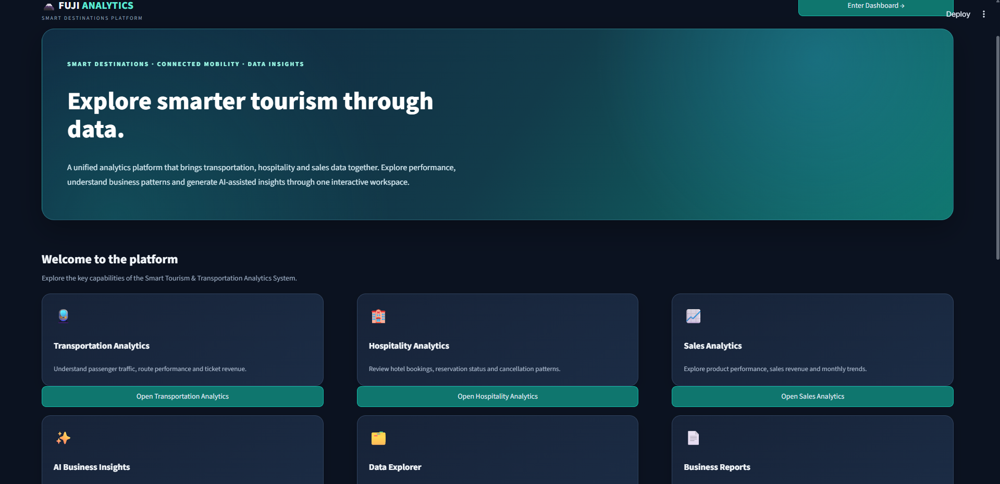
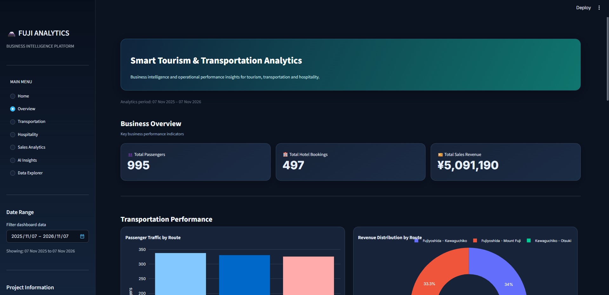
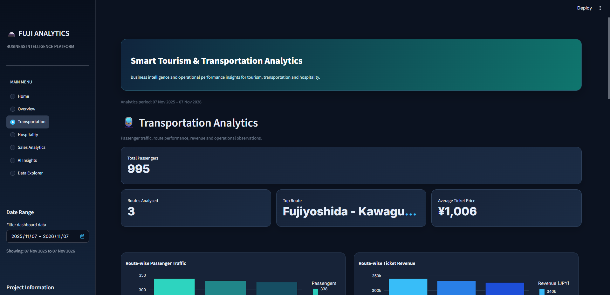
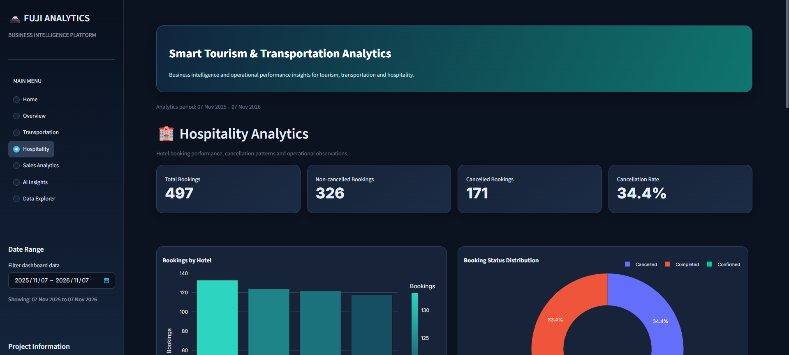
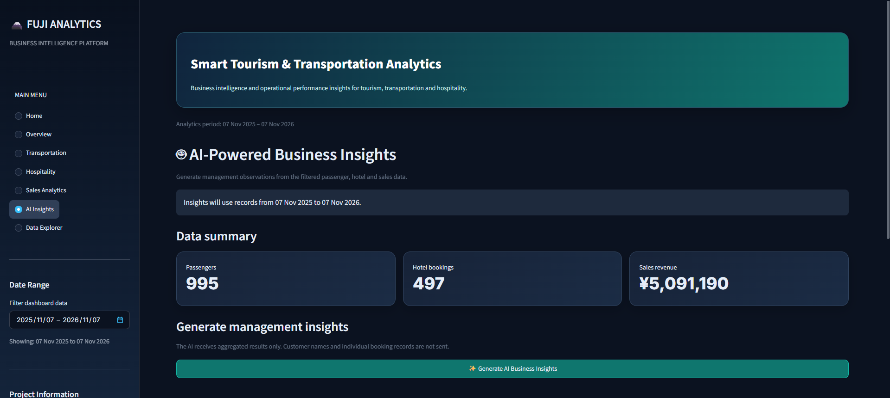

# 🗻 FUJI ANALYTICS
### Smart Tourism & Transportation Analytics Platform

**Turning tourism data into meaningful business insights.**

An interactive analytics platform that combines transportation, hospitality, and sales data to help understand business performance and support data-driven decisions.

---

## 🌟 Project Overview

FUJI ANALYTICS is a Python-based business intelligence application developed to demonstrate how data analytics, database management, interactive visualization, and Generative AI can support tourism-related operations.

The platform integrates multiple datasets into a centralized MySQL database and presents useful insights through an interactive Streamlit dashboard.

## 🚀 Key Features

| Module | Description |
|---|---|
| 🏠 Home | Website-style landing page with platform introduction and navigation |
| 📊 Overview | Key performance indicators across business areas |
| 🚆 Transportation | Route-wise passenger analysis, ticket revenue, and travel trends |
| 🏨 Hospitality | Hotel bookings, cancellation rates, and booking performance |
| 💴 Sales Analytics | Product-wise revenue, sales volume, and monthly trends |
| 🤖 AI Insights | AI-assisted business observations and recommendations |
| 🗂️ Data Explorer | Explore passenger, hotel, and sales datasets |
| 📄 PDF Reports | Generate downloadable business performance reports |

## 🛠️ Technology Stack

- **Programming:** Python
- **Database:** MySQL, SQL
- **Data Analysis:** Pandas
- **Frontend & Dashboard:** Streamlit
- **Visualization:** Plotly
- **Generative AI:** Groq API
- **PDF Generation:** ReportLab
- **Testing:** Python unittest
- **Version Control:** Git and GitHub

## 🏗️ System Architecture

```text
     CSV DATASETS
          |
          ▼
    MYSQL DATABASE
          |
          ▼
    PYTHON + SQL
     DATA ANALYSIS
          |
          ▼
   STREAMLIT DASHBOARD
          |
     ┌────┴─────┐
     ▼          ▼
  PLOTLY      GROQ AI
  CHARTS      INSIGHTS
     |          |
     └────┬─────┘
          ▼
    BUSINESS REPORTS
```

## 📁 Project Structure

```text
Smart_Tourism_Analytics/
│
├── data/                  # Sample datasets
├── database/              # MySQL schema
├── src/                   # Python modules
├── tests/                 # Automated tests
├── .streamlit/            # Streamlit configuration
├── app.py                 # Main dashboard
├── requirements.txt       # Dependencies
├── README.md
└── .gitignore
```

## ⚙️ Installation & Execution

**1. Clone the repository**

```bash
git clone https://github.com/DRONAVALLIANUHYA/Smart_Tourism_Analytics.git
cd Smart_Tourism_Analytics
```

**2. Create a virtual environment**

```powershell
python -m venv venv
.\venv\Scripts\Activate.ps1
```

**3. Install dependencies**

```bash
pip install -r requirements.txt
```

**4. Configure MySQL**

Create the database using:

```powershell
Get-Content database/schema.sql | mysql -u root -p
```

Configure your local database credentials and import the datasets:

```bash
python -m src.import_data
```

**5. Configure Groq API (Optional)**

Create `.streamlit/secrets.toml` and add your API key and model configuration. Keep this file private.

**6. Launch the application**

```bash
streamlit run app.py
```

## 🧪 Testing

Run automated data-quality tests:

```bash
python -m unittest discover -s tests -v
```

**Current result:** 3 data-quality tests passed, covering passenger, hotel booking, and sales datasets.

## 💡 Project Impact

This project demonstrates how technology can support tourism-related business operations through:

- Better visibility into passenger traffic and route performance.
- Improved understanding of hotel booking and cancellation patterns.
- Product-level sales and revenue analysis.
- AI-assisted business observations.
- Centralized data access and downloadable reporting.

## 🔮 Future Scope

- Integration of authorized real-world tourism datasets.
- Advanced demand and operational analytics.
- Cloud deployment and role-based access.
- Expanded automated testing and monitoring.

---

## 📌 Important Note

This is an academic portfolio project using synthetic sample datasets. It is inspired by transportation and tourism business use cases and is not an official Fuji Kyuko application or connected to its internal systems.

## 📸 Dashboard Preview

### Home Page


### Overview Dashboard


### Transportation Analytics


### Hospitality Analytics


### Sales Analytics


### AI Insights


<div align="center">

**Built with Python, SQL, Data Analytics & Generative AI.**

*Explore data. Discover patterns. Support better decisions.*

</div>